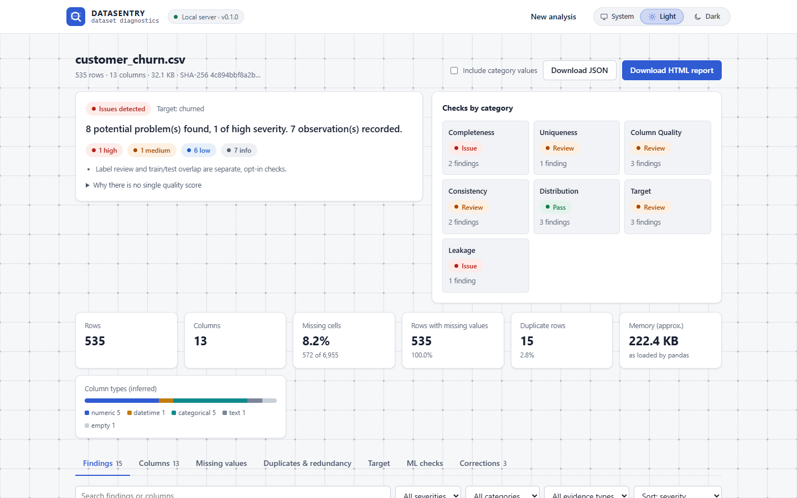
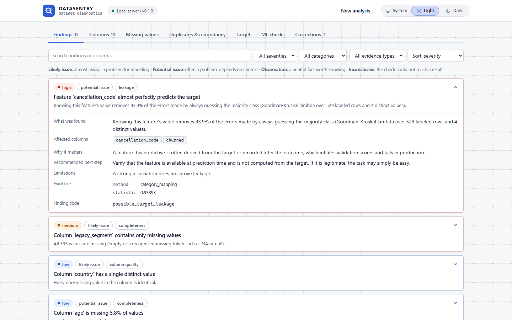
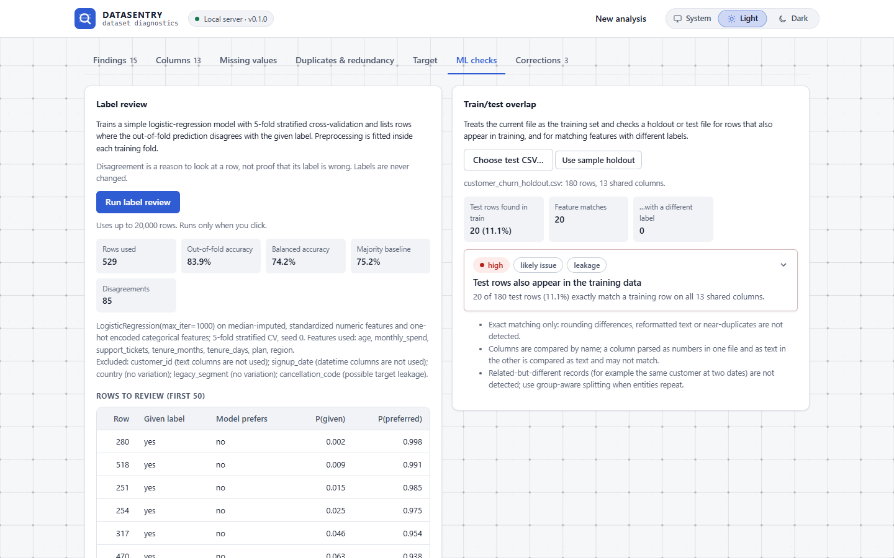
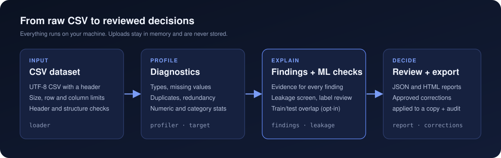
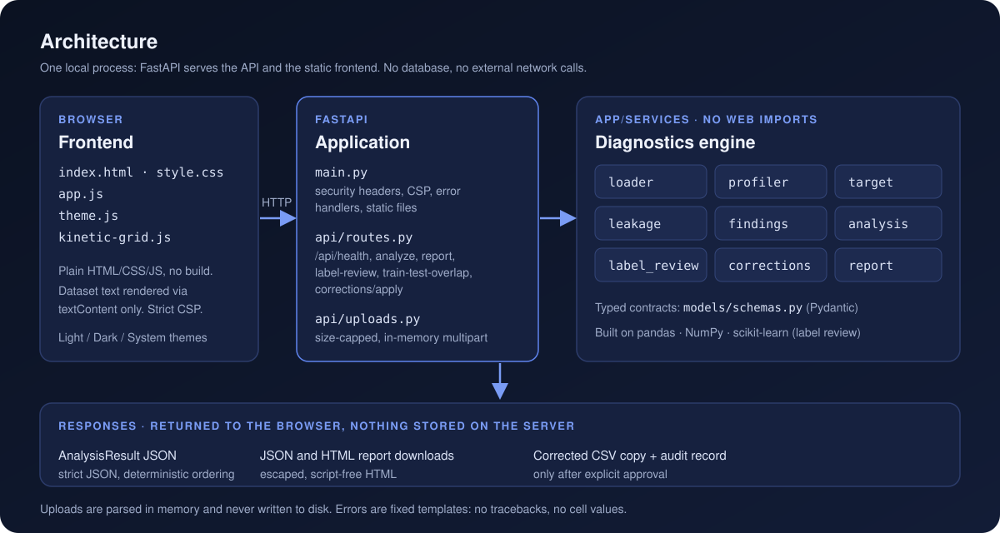

<div align="center">

<picture>
  <source media="(prefers-color-scheme: dark)" srcset="docs/assets/datasentry-logo-dark.svg">
  <source media="(prefers-color-scheme: light)" srcset="docs/assets/datasentry-logo.svg">
  
</picture>

### Find dataset problems before they become model problems.

DataSentry is a local-first dataset diagnostics tool that helps machine learning practitioners
identify data quality issues, investigate potential leakage, review dataset risks, and make
informed corrections before model training.


[Quick start](#quick-start) · [Capabilities](#key-capabilities) · [How it works](#how-it-works) · [API](#api-reference) · [Methodology](#diagnostic-methodology) · [Security](#security-and-privacy)

</div>

<br>

<picture>
  <source media="(prefers-color-scheme: dark)" srcset="docs/screenshots/overview-dark.png">
  <source media="(prefers-color-scheme: light)" srcset="docs/screenshots/overview-light.png">
  
</picture>

<sub>Real screenshot of the running app, analyzing the synthetic <code>sample_data/customer_churn.csv</code> with <code>churned</code> as the target. Images follow your GitHub light or dark theme where supported.</sub>

## Contents

- [Why DataSentry](#why-datasentry)
- [Key capabilities](#key-capabilities)
- [How it works](#how-it-works)
- [Example finding](#example-finding)
- [How to read the results](#how-to-read-the-results)
- [Quick start](#quick-start)
- [Running tests](#running-tests)
- [API reference](#api-reference)
- [Diagnostic methodology](#diagnostic-methodology)
- [Security and privacy](#security-and-privacy)
- [Limitations](#limitations)
- [Roadmap](#roadmap)
- [Contributing](#contributing)

## Why DataSentry

Many model failures start as data problems: a duplicated record that lands on both sides of a
split, a column recorded after the outcome, a target with a handful of rare classes, or numbers
quietly stored as text. Generic profilers list statistics; DataSentry turns them into
**explained findings**. Each finding states what was measured, why it matters for modeling, what to
check next, and the limits of the evidence.

It deliberately does **not** produce a single "data quality score". Any weighting of missing values
against leakage or label noise would be arbitrary and could hide one severe problem behind a good
number. Instead it reports each category separately and says which checks did not run.

## Key capabilities

| Area | What you get |
|---|---|
| **Validation** | Safe in-memory CSV parsing with size, row and column limits; empty, duplicate and malformed headers caught before pandas silently renames them |
| **Profiling** | Inferred types, missing values, exact duplicate rows, numeric statistics with IQR outlier candidates, category frequencies and rare categories |
| **Column quality** | Constant and near-constant columns, identifier-like and high-cardinality columns, identical columns, near-perfectly correlated numeric pairs |
| **Consistency** | Numbers stored as text, category variants that differ only in case or spacing, stray whitespace, infinite values |
| **Target analysis** | Classification vs. regression inference, class balance, rare and single classes, missing labels, identical rows with conflicting labels |
| **Leakage screen** | Single features that predict the target almost perfectly, reported as signals to verify, never as proof |
| **ML checks (opt-in)** | Cross-validated label review that lists rows worth a second look; train/test overlap between two files |
| **Approved corrections** | Remove unlabeled rows, exact duplicates or empty/constant/copied columns, only after explicit approval, applied to a copy, with an audit record |
| **Reports** | Strict JSON and a self-contained, script-free HTML report |
| **Interface** | Drag-and-drop upload, filterable findings, column explorer, light / dark / system themes, keyboard support, responsive layout |

<table>
  <tr>
    <td width="50%">
      <picture>
        <source media="(prefers-color-scheme: dark)" srcset="docs/screenshots/findings-dark.png">
        <source media="(prefers-color-scheme: light)" srcset="docs/screenshots/findings-light.png">
        
      </picture>
      <p align="center"><sub><b>Findings</b>: every finding shows its evidence and limitations</sub></p>
    </td>
    <td width="50%">
      <picture>
        <source media="(prefers-color-scheme: dark)" srcset="docs/screenshots/ml-checks-dark.png">
        <source media="(prefers-color-scheme: light)" srcset="docs/screenshots/ml-checks-light.png">
        
      </picture>
      <p align="center"><sub><b>ML checks</b>: label review and train/test overlap</sub></p>
    </td>
  </tr>
</table>

## How it works

<p align="center">
  
</p>

<p align="center">
  
</p>

The services in `app/services/` are plain Python with no web framework imports, so every diagnostic
can be tested without HTTP. A request flows as `routes.py` (byte-capped upload) → `loader.load_csv`
(validation) → `analysis.run_analysis` (profiling, target and findings stages) → a Pydantic
`AnalysisResult`. If one stage fails, the result is marked `partial` and names the missing checks
instead of pretending the analysis was complete.

<details>
<summary><b>Repository layout</b></summary>

```text
app/
  config.py            Resource limits (env-overridable) and the application version
  main.py              App factory: routes, error handlers, security headers, static frontend
  api/
    routes.py          HTTP endpoints only; heavy work runs in a worker thread
    uploads.py         Bounded, in-memory multipart parsing (uploads never touch disk)
  models/
    schemas.py         Pydantic response contracts (strict JSON: no NaN/Infinity)
  services/            Pure Python; no FastAPI imports
    loader.py          CSV validation and parsing; DatasetError for expected, user-safe failures
    profiler.py        Types, missing values, duplicates, numeric/categorical stats, redundancy
    target.py          Target task inference, class distribution, label conflicts
    leakage.py         Target-leakage screen and train/test overlap
    findings.py        Rules that turn observations into findings; qualitative summary
    analysis.py        Orchestrates stages; a failing stage marks the result "partial"
    label_review.py    Opt-in cross-validated label review (scikit-learn)
    corrections.py     Proposed corrections and approved, audited application
    report.py          JSON report document and escaped HTML rendering
frontend/              index.html, style.css, app.js, theme.js, kinetic-grid.js (no build step)
sample_data/           Synthetic demo datasets (see sample_data/README.md)
scripts/               generate_sample_data.py (deterministic, seed 42)
tests/                 pytest suite (unit, API integration, security boundaries, determinism)
docs/                  README artwork and screenshots
reports/               Reserved for report artifacts (nothing is written here automatically)
```

</details>

## Example finding

This is real output from `POST /api/analyze` on the synthetic churn sample. The sample's
`cancellation_code` column is deliberately recorded only for customers who already churned:

```json
{
  "code": "possible_target_leakage",
  "kind": "potential_issue",
  "severity": "high",
  "category": "leakage",
  "title": "Feature 'cancellation_code' almost perfectly predicts the target",
  "explanation": "Knowing this feature's value removes 93.9% of the errors made by always guessing the majority class (Goodman-Kruskal lambda over 529 labeled rows and 4 distinct values).",
  "why_it_matters": "A feature this predictive is often derived from the target or recorded after the outcome, which inflates validation scores and fails in production.",
  "recommendation": "Verify that the feature is available at prediction time and is not computed from the target. If it is legitimate, the task may simply be easy.",
  "limitations": "A strong association does not prove leakage.",
  "columns": ["cancellation_code", "churned"],
  "evidence": { "method": "category_mapping", "statistic": 0.938931 },
  "correction": null
}
```

The same run reports 8 potential problems and 7 observations. Class imbalance and outlier
candidates appear as observations, not defects.

## How to read the results

| What you see | What it means | What DataSentry does |
|---|---|---|
| **Observation** (`info`) | A neutral fact worth knowing: class imbalance, outlier candidates, an identifier-like column | Reports it; never counts it as a problem |
| **Potential issue** | A pattern that often hurts modeling but depends on context, including every **leakage signal** | Explains the evidence and the next check |
| **Likely issue** | A fact that is almost always a problem, such as an all-missing or single-class column | Flags it with a clear reason |
| **Inconclusive** | A check that could not reach a result (too few values, zero spread) | Says so instead of implying a clean result |
| **Suggested correction** | A proposed change linked to findings | Nothing happens until you select it, read its implications and explicitly approve; the original file is never modified |

DataSentry never labels anything as a *confirmed* problem: deciding that is your call, with the
evidence in front of you. Statistics such as λ, ROC AUC or Pearson r are association measures, not
probabilities that a problem exists.

## Quick start

**Prerequisites:** Python 3.12 or newer (the pinned NumPy 2.5.4 requires it; development and
testing used Python 3.14.4 on Windows 11), and a modern browser. Node.js is optional, only for the
JavaScript syntax checks.

```powershell
# Windows PowerShell, from the repository root
py -3 -m venv .venv
.\.venv\Scripts\Activate.ps1      # if blocked: Set-ExecutionPolicy -Scope CurrentUser RemoteSigned
python -m pip install -r requirements.txt
python -m uvicorn app.main:app --host 127.0.0.1 --port 8000
```

On macOS or Linux, use `python3 -m venv .venv` and `source .venv/bin/activate`, then the same
`pip` and `uvicorn` commands.

Open <http://127.0.0.1:8000>. The FastAPI server also serves the frontend, so there is nothing else
to start. Click **Customer churn (classification)** to explore a synthetic dataset with planted
problems, or drop in your own CSV. Interactive API docs are at <http://127.0.0.1:8000/docs> (Swagger
UI loads its assets from a CDN; DataSentry itself does not).

<details>
<summary><b>Guided tour of the sample</b></summary>

1. Click **Customer churn (classification)**. It is analyzed with `churned` as the target.
2. The summary shows issues in *Completeness* and *Leakage*. Open the high-severity finding to see
   why `cancellation_code` looks like leakage, and why that is not proof.
3. Click a column chip such as `age` to open its distribution, outlier candidates and related
   findings.
4. On **ML checks**, run **Label review**, then **Use sample holdout** to find the 20 holdout rows
   copied from the training file.
5. On **Corrections**, select changes, read their implications, tick the approval box and apply.
   Download the corrected CSV and its audit record, or analyze the corrected copy.
6. Download the HTML or JSON report.

The planted issues are listed in [`sample_data/README.md`](sample_data/README.md). Regenerate the
samples with `python scripts/generate_sample_data.py`; the output is byte-for-byte reproducible.

</details>

### Configuration

| Setting | Default | Environment variable |
|---|---|---|
| Upload size per file | 10 MB (10,485,760 bytes) | `DATASENTRY_MAX_UPLOAD_BYTES` |
| Data rows | 200,000 | `DATASENTRY_MAX_ROWS` |
| Columns | 500 | `DATASENTRY_MAX_COLUMNS` |
| Concurrent analyses | 2 (others wait up to 30 s, then get 503) | `DATASENTRY_MAX_CONCURRENT_ANALYSES` |
| Label review rows | 20,000 | `DATASENTRY_MAX_LABEL_REVIEW_ROWS` |
| Dev-only live design tooling | unset | `DATASENTRY_DEV_LIVE_ORIGIN` |

`DATASENTRY_DEV_LIVE_ORIGIN` exists only for local design tooling. When set to a loopback origin
such as `http://localhost:8400`, it relaxes the Content-Security-Policy to allow that origin and
inline styles. Leave it unset in normal use.

Indicative timings from one development machine: a 7.4 MB file with 200,000 rows and 7 columns
loads in about 0.2 s and is analyzed in about 3 s; label review on 20,000 rows takes about 1 s.

## Running tests

```powershell
python -m pytest                              # unit, API integration, security and determinism tests
python -m compileall -q app tests scripts     # Python syntax
node --check frontend/app.js                  # JavaScript syntax (optional, requires Node.js)
node --check frontend/theme.js
node --check frontend/kinetic-grid.js
```

## API reference

All uploads are `multipart/form-data`. Options are form fields rather than query parameters, so
column names do not appear in access logs.

| Method | Path | Form fields | Returns |
|---|---|---|---|
| GET | `/api/health` | none | Status, version and active limits |
| POST | `/api/analyze` | `file`, optional `target_column` | `AnalysisResult` JSON |
| POST | `/api/report` | `file`, optional `target_column`, `format` (`json`/`html`), `include_values` (`true`/`false`, default `false`) | Report as a download |
| POST | `/api/label-review` | `file`, `target_column` | `LabelReviewResult` JSON |
| POST | `/api/train-test-overlap` | `train_file`, `test_file`, optional `target_column` | `TrainTestOverlapResult` JSON |
| POST | `/api/corrections/apply` | `file`, `plan` (JSON: `{"approved": true, "target_column": ..., "steps": [{"operation": ..., "columns": [...]}]}`) | Corrected CSV text and audit record |

```powershell
curl.exe -F "file=@sample_data/customer_churn.csv" -F "target_column=churned" http://127.0.0.1:8000/api/analyze
```

Errors always have the shape `{"error": "<stable_code>", "message": "<safe text>"}`, with status
400 (malformed request), 413 (size, row or column limit), 415 (not CSV / not multipart), 422
(invalid content or options), 500 (unexpected; no details) or 503 (server busy). Example codes:
`empty_file`, `no_data_rows`, `invalid_encoding`, `malformed_csv`, `empty_header`,
`duplicate_header`, `too_many_rows`, `too_many_columns`, `file_too_large`, `unsupported_format`,
`unknown_target_column`, `approval_required`, `invalid_plan`.

<details>
<summary><b>Analysis result structure</b></summary>

`AnalysisResult` (see `app/models/schemas.py`) contains `dataset` (name, size, SHA-256),
`settings`, `stages` (each `completed`, `failed` or `skipped`), `status` (`complete` or
`partial`), `overview`, `columns` (one profile per column, in file order), `duplicates`,
`redundancy`, `target`, `findings`, `summary`, `corrections` (proposals only) and `limitations`.
A section is `null` when its stage did not complete.

Each finding has a stable `code`, `kind` (`likely_issue`, `potential_issue`, `observation`,
`inconclusive`), `severity` (`high`, `medium`, `low`, `info`), `category`, `title`,
`explanation`, `why_it_matters`, `recommendation`, optional `limitations`, affected `columns`,
`evidence` (supporting statistics) and an optional `correction` id. Findings are sorted by
severity, kind, category, code and columns, so identical input always gives identical output.

</details>

**Reports.** JSON reports (`ReportDocument`) contain `metadata` (tool version, UTC generation
time, value-inclusion setting, serialization policy, privacy note), the full `analysis` and the
`methodology`. Output is strict JSON: NaN and infinity are never emitted, undefined statistics are
`null`, and floats are rounded to 6 decimals. Apart from `generated_at`, identical inputs and
settings give identical reports. HTML reports are a single self-contained file with an executive
summary, overview, findings, target analysis, column diagnostics, suggested corrections,
methodology, limitations and stage status. Every dynamic string is escaped, and the page declares
`Content-Security-Policy: default-src 'none'`. Reports never contain dataset rows; frequent
category values are omitted unless you opt in with *Include category values* /
`include_values=true`.

## Diagnostic methodology

Every threshold is a named constant in the module that uses it, and the same list is embedded in
each report's *Methodology* section.

**Input rules.** UTF-8 CSV (a byte-order mark is accepted) with a header row, comma separator and
standard double-quote quoting. Column names must be non-empty and unique. Every row must have as
many fields as the header; blank lines are skipped, and single fields larger than 128 KB are
rejected. Empty cells and pandas' default tokens (`NA`, `N/A`, `null`, `NaN`, `None`, and similar)
are treated as missing. Excel, PDF, archives and binary files are rejected with a message.

<details>
<summary><b>Thresholds and methods for every check</b></summary>

- **Type inference.** Numeric and boolean types come from the CSV parser. A text column is
  *boolean* if every value is `true`/`false` (any case), *datetime* if every value is an ISO 8601
  date or datetime, *categorical* if it has at most 50 distinct values or a distinct ratio of at
  most 0.5, and otherwise *text*. Other date formats (for example `01/02/2024`) stay categorical
  because they are ambiguous.
- **Missing values.** Columns missing at least 5% of values get their own finding (medium severity
  from 50%); smaller amounts are grouped into one observation. Missing target labels are reported
  only by the target checks.
- **Duplicates.** A duplicate row is an exact repeat of an earlier row across all columns,
  compared after parsing (`1` and `1.0` in a numeric column are equal), with missing values equal
  to each other. Only repeats are counted, not first occurrences. Medium severity from 5% of rows.
  Duplicates are never removed automatically.
- **Constant / near-constant.** Constant means at most one distinct non-missing value.
  Near-constant means the most frequent value covers at least 95% of at least 20 non-missing values
  (an observation, because rare-event flags are legitimate).
- **Identifier-like / high cardinality.** Identifier-like means at least 20 rows, no missing
  values, a distinct value in every row, and integer or string values. High cardinality means a
  categorical or text column with at least 50 distinct values covering at least half of its values.
  Both are observations; column names are never used.
- **Redundancy.** Identical columns are compared exactly. Numeric pairs with |Pearson r| ≥ 0.99 over
  at least 10 rows are observations. Screening is limited to 50 numeric columns, and the summary
  says when it was skipped.
- **Outlier candidates.** Tukey fences (Q1 − 1.5·IQR, Q3 + 1.5·IQR), computed with at least 10
  finite values and a non-zero IQR. Otherwise the screen is marked unavailable or inconclusive.
  Candidates are observations for review, never errors.
- **Numeric edge cases.** NaN is missing. ±∞ is counted separately and excluded from statistics
  (an `infinite_values` finding). The standard deviation needs at least 2 values. Undefined
  statistics are `null`.
- **Categories.** Up to 10 most frequent values are listed (ties alphabetical, values clipped to
  200 characters). Rare categories (under 1% of values) are evaluated only with at least 100
  values and at most 1,000 categories. Variants are values that become equal after trimming,
  collapsing whitespace and ignoring case. "Numbers stored as text" means at least 80% but not all
  values of a text column parse as numbers.
- **Target.** The target is never guessed. Boolean and non-numeric targets are classification.
  Integer-valued targets with at most 20 distinct values are classification (with a note that they
  may be quantities). Other numeric targets are regression. Up to 50 classes are listed. Rare
  classes have fewer than 5 examples (too few for 5-fold stratified CV). Imbalance (largest ÷
  smallest class) is an *observation* from 3:1 and never a defect by itself. Rows with identical
  features but different labels are reported as label conflicts.
- **Leakage screen** (needs at least 20 labeled rows). For classification, a feature that repeats
  values (at most one distinct value per two rows, 80% of rows in groups of two or more) with
  Goodman–Kruskal λ ≥ 0.8, meaning it removes at least 80% of the errors of always guessing the
  majority class; and, for binary targets, a numeric feature whose single-feature ROC AUC is
  ≥ 0.99 or ≤ 0.01. For regression, |Pearson r| ≥ 0.99. These are prompts to verify that the
  feature is available at prediction time. A strong association does not prove leakage, and leakage
  can exist without any of these signals.
- **Train/test overlap.** Rows are compared on shared columns using 64-bit hashes of parsed values
  (integer and float columns are aligned). A test row whose features match training but whose
  label does not is reported separately.
- **Label review.** Columns that are identifier-like, constant, empty, text, datetime,
  high-cardinality (more than 50 categories) or flagged by the leakage screen are excluded.
  Numeric features are median-imputed and standardized, and categoricals are one-hot encoded,
  inside a scikit-learn `Pipeline`, so preprocessing is fitted on training folds only. A
  `LogisticRegression` is evaluated with `StratifiedKFold(5, shuffle=True, random_state=0)` using
  `cross_val_predict`. Rows whose out-of-fold prediction differs from the given label are listed,
  lowest given-label probability first (up to 50). Out-of-fold accuracy, balanced accuracy and the
  majority-class baseline are reported so you can judge whether the model is informative. Classes
  with fewer than 5 examples are excluded. Model disagreement is not proof of a wrong label, and
  labels are never changed.
- **Summary.** No numeric score. Each category is `issue` (a likely or potential problem of high or
  medium severity), `review` (lower-severity problems or inconclusive checks), `pass` (only
  observations) or `not_evaluated` (its checks did not run). Nothing in DataSentry predicts model
  accuracy.

</details>

## Security and privacy

- **Local and private.** One local process; no analytics, accounts, database, LLM or external API.
  The frontend loads no external assets.
- **Uploads never touch disk.** A size-capped, in-memory multipart reader (`app/api/uploads.py`)
  rejects oversized bodies while streaming. A test fails if an upload is ever spooled to a
  temporary file. Nothing is kept after the request.
- **Untrusted input stays data.** Uploads are only parsed as CSV: no `eval`, pickle, Excel parsing
  or code execution. Client filenames are reduced to a safe display name and never used as paths;
  tests check that path traversal on static files returns 404.
- **Safe errors and logs.** Error responses use fixed templates with no cell values and no
  tracebacks. Logs record only exception types, stage names and request paths, because library
  exception messages can quote data.
- **Safe rendering.** The UI inserts dataset strings as text only (`textContent`) and is served
  with a strict Content-Security-Policy (`script-src 'self'`, no inline scripts), `nosniff`,
  `X-Frame-Options: DENY` and `Referrer-Policy: no-referrer`. HTML reports cannot run scripts.
- **Approved changes only.** Corrections require `approved: true`, never modify the upload, and
  return an audit record with input and output SHA-256 hashes.

**Review scope.** The upload path, CSV parsing, error handling, logging, HTML rendering, static
files, serialization and the cost of every diagnostic were reviewed and covered by regression tests.
This was not a penetration test, and there is no authentication, so bind the server to `127.0.0.1`
as shown. Request bodies are buffered before the concurrency limit applies, so many simultaneous
large uploads can still use a lot of memory. A corrected CSV contains your data unchanged; cells
starting with `=`, `+`, `-` or `@` may be read as formulas by spreadsheet programs.

## Limitations

- CSV only: comma-separated, UTF-8. Other delimiters and encodings are rejected rather than guessed.
- Only exact duplicates and exact train/test matches are detected, not near-duplicates or related
  records (for example the same customer at two dates).
- Datetime recognition is ISO 8601 only. Booleans are recognized as `true`/`false`, not `yes`/`no`.
- Heuristics with fixed thresholds can produce false positives and false negatives; every finding
  says what it is based on.
- The leakage screen catches only single features with near-perfect association. It cannot detect
  temporal leakage, leakage through feature engineering, or leakage spread across several columns.
- Label review uses one linear model; a weak model makes its disagreements uninformative (the UI
  warns when balanced accuracy is below 0.7).
- The server keeps no state: each action re-uploads the file from the browser, so every analysis
  is recomputed.
- Not implemented: controlled model-impact experiments, Cleanlab-based label analysis, imputation
  as a correction (imputation belongs inside a training pipeline, fitted on training data only),
  authentication and multi-user deployment.

## Roadmap

- Reproducible model-impact experiments (for example duplicate contamination across a split, or
  controlled label noise) with a fixed baseline, an isolated test set and multiple seeds.
- Group-aware and temporal train/test checks using an entity or time column chosen by the user.
- Near-duplicate detection (normalized text, numeric tolerance).
- Configurable missing-value tokens, delimiter and encoding.
- Optional Cleanlab integration for label issues, once its dependency footprint is justified.
- Frontend unit tests and an automated browser test in CI.

## Contributing

Issues and pull requests are welcome. Before opening a pull request:

1. Keep the boundaries: diagnostics live in `app/services/` and never import FastAPI; HTTP concerns
   stay in `app/api/`; the frontend renders untrusted text with `textContent` only.
2. Add focused tests for new behavior, including empty, malformed and degenerate inputs, and run
   `python -m pytest`.
3. Keep findings honest: state the evidence and its limitations, keep observations separate from
   problems, and update the thresholds in the code, the report methodology and this README
   together.

Project conventions for contributors and coding agents are in [`CLAUDE.md`](CLAUDE.md); the visual
system is documented in [`DESIGN.md`](DESIGN.md).
